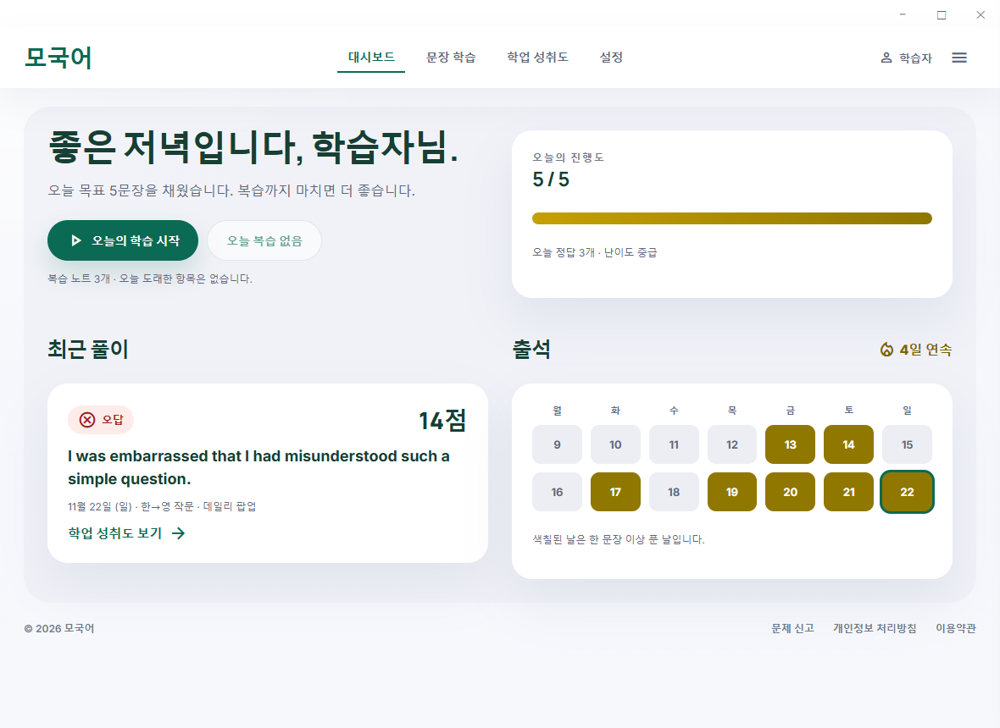

# 모국어 (MoGugeo)

> 매일 아침 5분, 데스크톱에서 영어 학습 루틴을 만드는 Windows Electron 앱.

| 대시보드 | 데일리 팝업 |
|---|---|
|  |  |

정해진 시각이 되면 앱이 꺼져 있어도 번역 미션 팝업이 뜨고, 틀린 문장은 망각곡선 간격으로 다시 나옵니다. 아침에 PC를 켤 때 짧게라도 영어를 보게 하려고 만든 개인 프로젝트입니다.

## 주요 기능

- **로컬 프로필** — 닉네임과 난이도(초급·중급·고급)만 정하면 시작. 프로필과 학습 기록은 이 PC(렌더러 localStorage)에만 저장되며 비밀번호·서버 인증은 없다. 계정 서버 연동(Supabase Auth)은 다음 버전 예정
- **데일리 팝업** — 매일 정해진 시각에 번역 미션 2문제(영→한, 한→영)가 뜬다. 설치본에서는 Windows 작업 스케줄러에 등록되어 앱이 꺼져 있어도 실행된다(작업 정의에 `StartWhenAvailable` 을 켜 두어 예정 시각을 놓쳐도 다음 기회에 실행). 하루 1회
- **문장 해석** — 선택한 난이도의 영어 문장(전체 50개: 초급 15·중급 20·고급 15) 중 아직 안 푼 문장을 순서대로 출제, 다 풀면 안내 후 오래된 순으로 다시 풀기 → 채점(0~100점, 60점 이상 정답) → 정답/오답·점수·내 답안과 모범답안·팁·문법 피드백
- **복습 큐** — 틀린 문장은 자동으로 복습 노트에 들어가 다음 날부터 1·3·7·30일 간격으로 다시 나온다. 대시보드·학업 성취도 화면의 "복습 시작"으로 바로 풀 수 있다
- **학업 성취도** — 학습 기록으로 계산한 연속 학습일, 최근 7일 정답률, 최근 12주 학습 빈도, 복습 노트 현황
- **TTS 발음** — 문장 해석 화면에서 영어 음성으로 발음 재생. 브라우저 음성 목록에 영어 음성이 없으면 Windows 음성(SAPI)의 영어 음성으로 읽고, 영어 음성이 아예 없으면 설치 방법을 안내한다(한국어 음성으로 영어를 읽지 않음)
- **오프라인 동작** — 문장 데이터와 글꼴·아이콘을 앱에 포함해 인터넷 없이 동작
- **다크 모드**, 트레이 아이콘, 단일 인스턴스(앱 실행 중 팝업 예약이 오면 기존 창에서 팝업만 연다)

> 채점은 토큰·핵심어 일치 기반의 규칙 채점이다. 의역은 작은 동의어 사전과 문장별 허용 답안(`answers[]`)으로만 인정한다.
> 핵심어만 나열하거나 조사를 모두 뗀 답(영작은 관사·전치사를 모두 뺀 답)은 문장이 아니므로 감점해 통과하지 못한다.
> 메인 창과 데일리 팝업 창이 같은 저장소를 쓰므로, 저장할 때마다 최신 상태를 다시 읽어 다른 창의 기록을 덮어쓰지 않는다.
> 단어 학습·원어민 표현은 비활성화되어 화면은 `src/renderer/_disabled/` 에, 데이터는 `src/data/` 에 보존만 되어 있다.
> 자세한 정의는 `Document/FeatureSpec.md` 참조.

## 개발 환경

- Node.js 20+
- TypeScript 5.9
- Electron 37
- electron-builder 26

## 명령어

```bash
npm install          # 의존성 설치
npm run build        # TypeScript 컴파일
npm test             # 빌드 후 단위 테스트 (node --test)
npm start            # 로컬 개발 실행
npm run dist         # Windows NSIS 인스톨러 생성 (release/)
```

- 개발 모드(`npm start`)에서는 작업 스케줄러 등록과 Windows 시작 프로그램 등록을 하지 않는다. 설치본에서만 설정값대로 반영된다.
- 단위 테스트는 `test/` 에 있다: 채점, 복습 간격, 학습 기록 집계(연속일·7일 정답률·히트맵), 상태 마이그레이션, 작업 스케줄러 XML 생성·출력 디코딩, Windows 음성 호출. CI 에서도 빌드 후 실행한다.

## 디렉토리 구조

```
MoGugeo/
├── src/
│   ├── main.ts              # Electron 메인 프로세스 (창·트레이·IPC·단일 인스턴스)
│   ├── preload.ts           # 컨텍스트 브릿지
│   ├── scheduler.ts         # 작업 스케줄러 등록/조회
│   ├── taskXml.ts           # 작업 정의 XML 생성, 콘솔 출력 디코딩
│   ├── speech.ts            # Windows 영어 음성 재생 (브라우저에 영어 음성이 없을 때)
│   ├── data/                # 학습 콘텐츠 JSON
│   │   ├── sentences.json   # 문장 50개 (활성)
│   │   ├── words.json       # 단어 100개 (비활성 콘텐츠 — 보존)
│   │   ├── expressions.json # 표현 30개 (비활성 콘텐츠 — 보존)
│   │   └── meta.json        # 콘텐츠 매니페스트
│   └── renderer/            # UI (HTML/CSS/JS)
│       ├── core.js          # 채점·복습·통계·상태 로직 (DOM 없음, 테스트 대상)
│       ├── app.js           # 화면별 처리
│       ├── fonts/           # 번들 글꼴 (Inter, Manrope, Material Symbols)
│       └── _disabled/       # 비활성화된 화면 백업 (vocabulary, expressions)
├── test/                    # 단위 테스트 (node --test)
├── build/                   # 아이콘 리소스
├── scripts/                 # 빌드 후처리
├── Document/                # 기획/설계/운영 문서
│   ├── FeatureSpec.md       # 5개 기능 상세 정의
│   ├── Architecture-v2.md   # DB·인프라 아키텍처
│   ├── Roadmap.md           # 통합 체크리스트
│   ├── PrivacyPolicy.md     # 개인정보 처리방침
│   └── TermsOfService.md    # 이용약관
└── docs/                    # 소개 페이지, 스크린샷
```

## 콘텐츠 갱신

`src/data/sentences.json` 을 교체하면 콘텐츠 업데이트 가능. v2 부터는 Supabase DB 가 콘텐츠 정본이 되고, 클라이언트는 동기화 후 로컬 캐시한다 (`Document/Architecture-v2.md` 참조).

## 출시 로드맵

- v1.0.0 — 초기 빌드 (2026-04-10)
- **STAGE C** — 클라이언트 기능 완성 (localStorage 기반): 채점·데일리 팝업 스케줄러·복습 큐·다크모드·TTS 등
- **STAGE P1~P4** — Supabase 기반 v2: 콘텐츠 백엔드 → 인증 → 데이터 동기화 → 운영 기능
- 자세한 단계는 `Document/Roadmap.md`

## 인프라

전부 무료 티어로 구성 (Supabase + GitHub). 유료 전환 계획 없음.

## 라이선스

MIT
