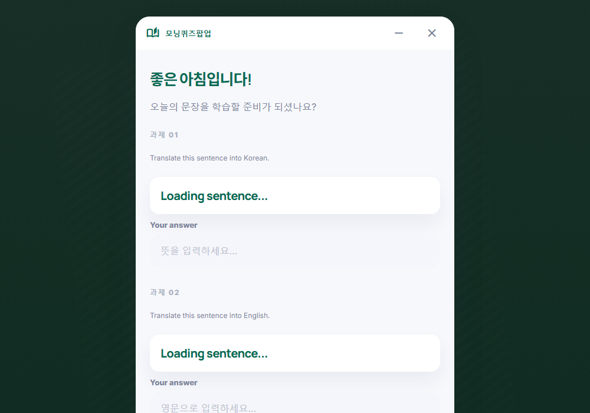

# 모국어 (MoGugeo)

> 매일 아침 5분, 데스크톱에서 영어 학습 루틴을 만드는 Windows Electron 앱.

| 대시보드 | 데일리 팝업 |
|---|---|
|  |  |

정해진 시각이 되면 앱이 꺼져 있어도 번역 미션 팝업이 뜨고, 틀린 문장은 망각곡선 간격으로 다시 나옵니다. 아침에 PC를 켤 때 짧게라도 영어를 보게 하려고 만든 개인 프로젝트입니다.

## 주요 기능

- **회원가입 / 로그인 화면** — 입력값 검증까지 구현. 실제 계정 인증(Supabase Auth)은 v2에서 연동 예정
- **데일리 팝업** — 매일 정해진 시각에 번역 미션 2문제(영→한, 한→영)가 자동으로 뜬다. 앱이 꺼져 있어도 Windows Task Scheduler 로 트리거
- **문장 해석** — 영어 문장을 한국어로 번역 → 채점 → 모범답안·팁·문법 피드백
- **학업 성취도** — 스트릭, 정답률, 학습 빈도 히트맵, 복습 큐 현황
- **복습 큐** — 틀린 문장을 망각곡선(1·3·7·30일)에 맞춰 재출제
- **TTS 발음** — 문장 해석 화면에서 발음 재생
- **오프라인 동작** — 콘텐츠 캐시 후 인터넷 없이 학습 가능

> 단어 학습·원어민 표현은 현재 비활성화되어 `src/renderer/_disabled/` 에 백업되어 있다.
> 레벨 시스템도 제거됨. 자세한 정의는 `Document/FeatureSpec.md` 참조.

## 개발 환경

- Node.js 20+
- TypeScript 5.9
- Electron 37
- electron-builder 26

## 명령어

```bash
npm install          # 의존성 설치
npm run build        # TypeScript 컴파일
npm start            # 로컬 개발 실행
npm run dist         # Windows NSIS 인스톨러 생성 (release/)
```

## 디렉토리 구조

```
MoGugeo/
├── src/
│   ├── main.ts              # Electron 메인 프로세스
│   ├── preload.ts           # 컨텍스트 브릿지
│   ├── data/                # 학습 콘텐츠 JSON
│   │   ├── sentences.json   # 문장 50개 (활성)
│   │   ├── words.json       # 단어 100개 (비활성 콘텐츠 — 보존)
│   │   ├── expressions.json # 표현 30개 (비활성 콘텐츠 — 보존)
│   │   └── meta.json        # 콘텐츠 매니페스트
│   └── renderer/            # UI (HTML/CSS/JS)
│       └── _disabled/       # 비활성화된 화면 백업 (vocabulary, expressions)
├── build/                   # 아이콘 리소스
├── scripts/                 # 빌드 후처리
├── Document/                # 기획/설계/운영 문서
│   ├── FeatureSpec.md       # 5개 기능 상세 정의
│   ├── Architecture-v2.md   # DB·인프라 아키텍처
│   ├── Roadmap.md           # 통합 체크리스트
│   ├── PrivacyPolicy.md     # 개인정보 처리방침
│   └── TermsOfService.md    # 이용약관
└── docs/                    # 소개 페이지, 스크린샷
```

## 콘텐츠 갱신

`src/data/sentences.json` 을 교체하면 콘텐츠 업데이트 가능. v2 부터는 Supabase DB 가 콘텐츠 정본이 되고, 클라이언트는 동기화 후 로컬 캐시한다 (`Document/Architecture-v2.md` 참조).

## 출시 로드맵

- v1.0.0 — 초기 빌드 (2026-04-10)
- **STAGE C** — 클라이언트 기능 완성 (localStorage 기반): 채점·데일리 팝업 스케줄러·복습 큐·다크모드·TTS 등
- **STAGE P1~P4** — Supabase 기반 v2: 콘텐츠 백엔드 → 인증 → 데이터 동기화 → 운영 기능
- 자세한 단계는 `Document/Roadmap.md`

## 인프라

전부 무료 티어로 구성 (Supabase + GitHub). 유료 전환 계획 없음.

## 라이선스

MIT
